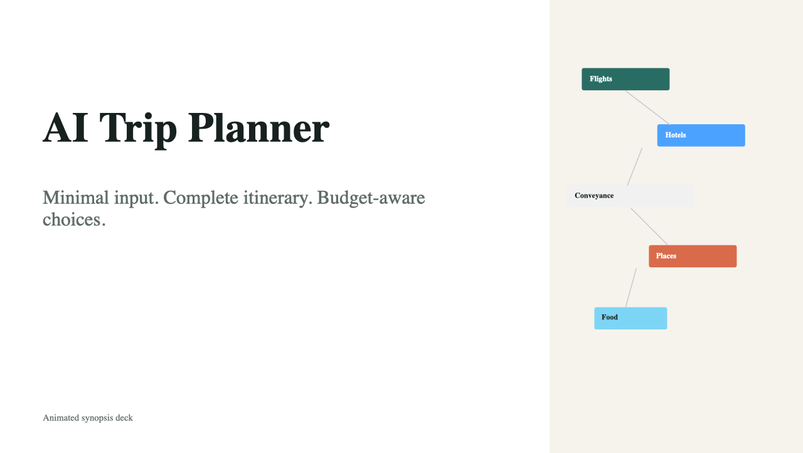

# AURA JOURNEYS — AI Trip Planner

An autonomous AI travel concierge and dynamic trip planning application built with React 19, TypeScript, Tailwind CSS, and Motion primitives.



## ✨ Features

- **Autonomous AI Synthesis:** Real-time route optimization and smart recommendation generation based on destination, travel party, and budget.
- **Dynamic Budget Architecture:** Interactive category-based budget rebalancing (Flights, Hotels, Conveyance, Places, and Food) across multiple strategy tiers (*Best*, *Value*, *Budget*).
- **Traveler & Party Management:** Manage travel profiles and party members seamlessly.
- **Interactive Itinerary Timeline:** Day-by-day schedules with curated activities, maps, and timings.
- **Curated Places Carousel:** High-resolution discovery of local highlights and attractions.
- **Deliverables & Presentations:** Automated PowerPoint presentation export script for trip synopses.

## 🛠 Tech Stack

- **Framework:** [React 19](https://react.dev/) + [Vite](https://vitejs.dev/)
- **Language:** [TypeScript](https://www.typescriptlang.org/)
- **Styling:** [Tailwind CSS](https://tailwindcss.com/)
- **Animations:** [Motion](https://motion.dev/) & custom motion primitives
- **Icons:** [Lucide React](https://lucide.dev/)
- **Exporting Tools:** PPTXGenJS, JSZip, fast-xml-parser

## 🚀 Getting Started

### Prerequisites

- Node.js (v18+)
- npm / yarn / pnpm

### Installation

1. Clone the repository:
   ```bash
   git clone https://github.com/Arnav876/ai-trip-planner.git
   cd ai-trip-planner
   ```

2. Install dependencies:
   ```bash
   npm install
   ```

3. Start the development server:
   ```bash
   npm run dev
   ```

4. Build for production:
   ```bash
   npm run build
   ```

## 📄 License

MIT
